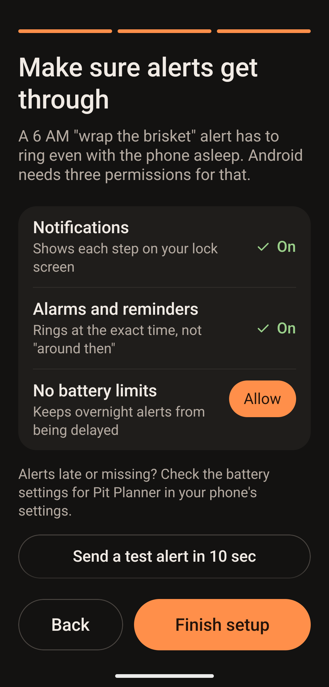
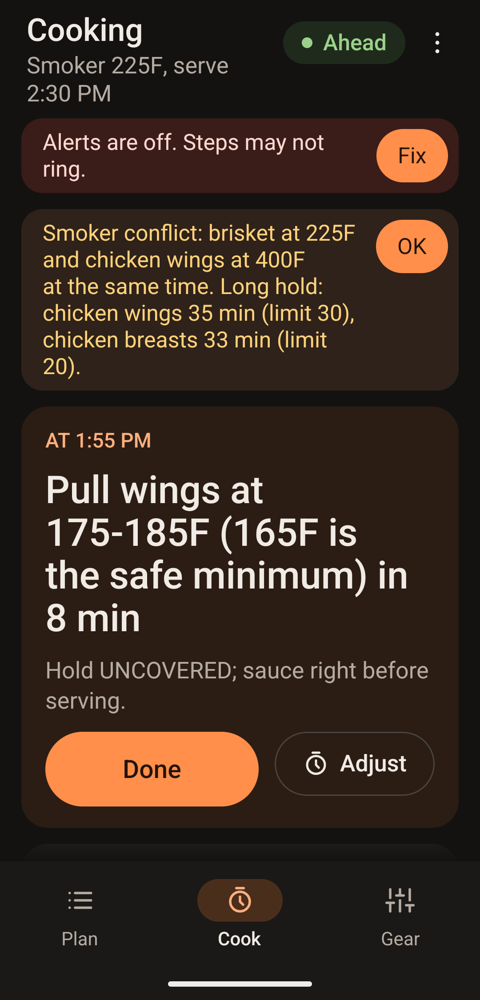
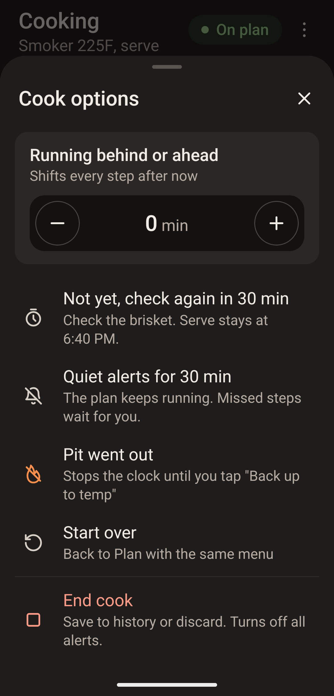
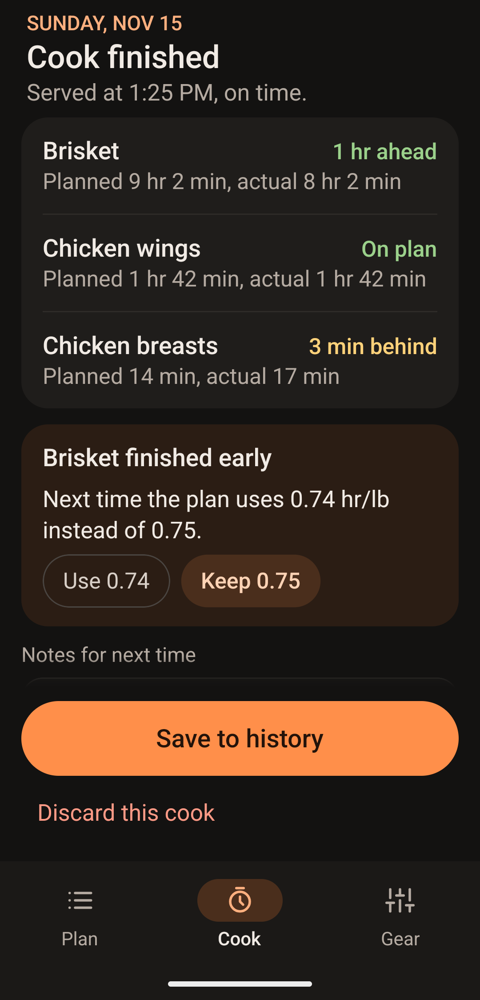
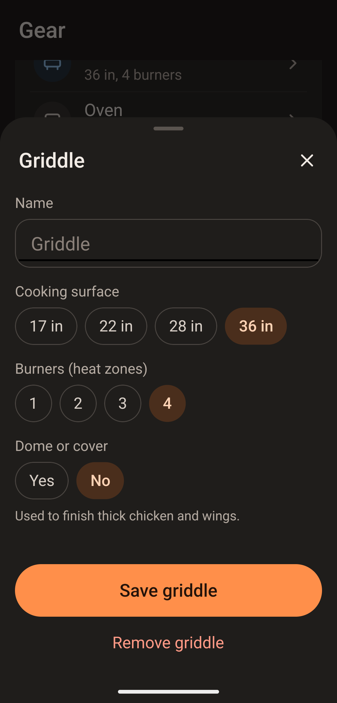

# Pit Planner user guide

Pit Planner is an Android app for planning a barbecue cook. You tell it what you are cooking and when you want
to eat. It works backward and tells you when to fire the smoker, when to put each food on, when to wrap and when
to pull. Then it rings a real alarm at each step, and it re-plans when the cook or the cook's human runs behind
or ahead.

Everything stays on your phone. There is no account and no server.

To install the app, see [INSTALL.md](INSTALL.md). This guide starts after the app is installed.

Temperatures in this guide are in Fahrenheit (F). The app can show Celsius (C) instead. You pick this in
Setup, and you can change it later in Gear, under Units. Weights can be pounds or kilograms the same way.

## Contents

1. First launch
2. Plan
3. Start cook and Live cook
4. Cook options
5. Cook finished
6. Gear
7. Cook history and cook rates
8. Share a plan, open a shared plan
9. Updates
10. If an alarm does not ring
11. Help and the debug screen

## 1. First launch

The first time you open the app, Setup asks three short things. Nothing is saved until you tap Finish setup.

<!-- SCREENSHOT: setup-welcome | Setup step 1, Welcome to Pit Planner, units chosen, status bar cropped -->

**Welcome to Pit Planner.** Pick Fahrenheit or Celsius, and Pounds or Kilograms. Tap Continue.

<!-- SCREENSHOT: setup-cookers | Setup step 2, What do you cook on, smoker, griddle and oven rows, status bar cropped -->

**What do you cook on?** Tap the Smoker card to pick your model. Turn on Griddle if you have one. Turn on
Oven for holding if you will hold food warm in the oven. Tap Add another cooker for more. You need a smoker or
a griddle to continue. You can change all of this later in Gear.

<!-- SCREENSHOT: setup-picker | The smoker picker with search and type chips, status bar cropped -->

In the smoker picker, search by brand or model, or use the chips (All, Pellet, Kamado, Offset, Drum, Gravity,
Electric). If your smoker is not in the list, tap Not listed? Enter it yourself and fill in its details. When
the app knows your model, it fills in the hopper size and the grate area for you. You can edit both.

If your smoker's temps go up in different steps than the app shows, pick "Not listed? Enter it yourself" and
set your own step.

<!-- SCREENSHOT: setup-alerts | Setup step 3, Make sure alerts get through, three rows and the test button, status bar cropped -->

**Make sure alerts get through.** A 6 AM "wrap the brisket" alert has to ring with the phone asleep. Android
only allows that if you say yes to three things. Tap Allow on each row until it shows as on:

- Notifications shows each step on your lock screen.
- Alarms and reminders rings at the exact time, not "around then".
- No battery limits keeps overnight alerts from being delayed.

Some phones show a fourth row, Full-screen alerts. It wakes the screen for overnight steps. Allow that too.

Then tap Send a test alert in 10 sec and lock the phone. It should ring. If it does not, see section 10.

Tap Finish setup. You can finish without the permissions, but the app will ask again when you start a cook.

## 2. Plan

Plan is the first tab. Here you build the menu and see the times.

<!-- SCREENSHOT: plan-empty | Plan with nothing on the menu, What are we cooking, Add food button, status bar cropped -->

With nothing on the menu, Plan says "What are we cooking?" Tap Add food. Once you have a saved cook, a Cook a
past plan again button also shows. See section 7.

<!-- SCREENSHOT: plan-main | Plan with the Saturday menu, three foods, tiles at the bottom, 115% font, status bar cropped -->

### Serve time

At the top, pick Ready by or Start at.

- Ready by: you give the time you want to eat. The app works out when to start.
- Start at: you give the time you want to light the smoker. The app works out when you will eat.

Tap the day and time to change it. Tap the calendar icon to pick a date and time.

### Add food

<!-- SCREENSHOT: plan-add-food | The Add food sheet with the search box and the Beef, Pork, Chicken groups, status bar cropped -->

Tap Add food. Search for a food or scroll the groups. Tap a food to open its details.

### Food details

<!-- SCREENSHOT: plan-food-details | Food details for a brisket, with the result bar pinned at the bottom, status bar cropped -->

The food details screen shows what you can change for that food:

- The amount: weight for meats you cook by weight, or a count for things like chicken breasts.
- Cook on: the cookers you have. A cooker you did not set up is off and says "Add in Gear".
- Method and options, where the food has them. A method your cookers cannot do is shown but off. Its note
  says "Add in Gear", or "Needs" and a temperature if your smoker cannot get that hot.
- Rest after pull: how long the food rests before it is served.
- Timing: how the app works out the time on heat. For foods cooked by weight you pick Hours per pound, Total
  hours or Size-adjusted. Other foods use Standard or Total hours.
- Use for future: a check box to keep your rate or total hours for the next cook of this food.

A result card shows when the food goes on, when it comes off and when to fire the smoker. A bar pinned at the
bottom shows the same three times: Fire (or On), Off heat and Serve. The bar does not move as you change
things. Tap it to scroll to the full result card.

The food is not on the menu until you tap Add to plan. For a food already on the menu the buttons are Save and
Remove.

The first time you add a food, the app may say the published estimate is a guess and that most pellet smokers
run faster. Set your own rate or total hours if you know them.

### Smoker temp

<!-- SCREENSHOT: plan-temp-menu | The Smoker temp menu open, each row with its fire time, status bar cropped -->

Tap the Smoker temp field. A menu lists the temperatures your smoker can be set to. Each row shows the fire
time you would get with that temperature. Pick one. The menu starts with the usual range, 200F to 300F. Tap
the Show button at the bottom to see every temperature. Times outside the usual range are marked as a rough
guess.

### The tiles and Conflicts

<!-- SCREENSHOT: plan-conflicts | The Conflicts sheet with a warning and its fix buttons, status bar cropped -->

Under the menu, tiles show the fire time, the pellets (or charcoal) the cook needs, and Conflicts. Conflicts
shows None when the plan fits your cookers. When it shows a number, tap it. The sheet lists each problem in
plain words. Some problems come with a fix button:

- Move (food) to the griddle.
- Change smoker temp.
- Edit (food).

If the cook needs more pellets than your hopper holds, the Pellets tile turns orange. Tap it for the details.

A plan with a warning can still be started. The warnings are there so you can decide.

## 3. Start cook and Live cook

Tap Start cook on Plan. Starting a cook is only done from Plan.

If an alert permission is off, a sheet called "Alerts may not ring" opens first. Turn the permissions on, or
tap Start anyway and keep an eye on the clock. While a cook is running, Start cook is greyed out.

<!-- SCREENSHOT: start-check | The Alerts may not ring sheet with the permission rows, status bar cropped -->

The Cook tab opens. With no cook running, the Cook tab says "No cook running" and gives you a Go to Plan button.

### Live cook

<!-- SCREENSHOT: cook-live | Live cook with the Next up card, lane chart and next steps, 115% font, status bar cropped -->

The Live cook screen is titled Cooking. Under the title it shows the smoker temp and the serve time. A chip on
the right says On plan, Behind or Ahead. The three dots open Cook options.

The big card is Next up. It tells you the next step and how long until it is due, for example "Check the
brisket in 1 hr 12 min". Steps that depend on the food, such as wrapping, are worded as a check: look at the
food first.

- Done: tap when you have done the step. The app re-plans from what really happened.
- Adjust: opens Cook options, for when the food is not ready.

Below the card is a chart with one lane for each cooker, from the first step to serve. A line shows now. Under
the chart you see the next three steps. Tap Full timeline to see every step, with the done ones dimmed.

When you tap Done on a step five minutes or more early or late, a sheet asks what to do about serve time:

- Keep serve: the hold time (the time the food rests warm) changes instead.
- Move serve: serve time changes. The other foods move with it.

Each choice shows what it does to the hold. Tap Apply. When the app moved serve, a note on Live cook says so,
for example "Serve moved to 5:40 PM. The other foods moved with it." Tap OK to clear it.

### Warning banners

<!-- SCREENSHOT: cook-banner | Live cook with an amber warning banner and its OK button, status bar cropped -->

Banners sit at the top of Live cook.

- A red banner, "Alerts are off. Steps may not ring.", with Fix. Fix opens the permission rows.
- "Alarms could not be set. Steps will not ring." with Try again. Tap Try again to set the alarms again.
- "Pit out since (time). Steps are on hold." with Back up to temp. See section 4.
- An amber banner when a change causes a smoker conflict the plan did not have before, or makes a hold
  longer than the food should wait. It says what changed. It does not ring. Tap OK to hide it.

### The alert on your lock screen

<!-- SCREENSHOT: lock-screen-alert | The step alert on the lock screen with the Done and +15 min buttons, status bar cropped -->

Each step rings as a real alarm, even with the phone asleep or locked. The alert has two buttons:

- Done: the same as Done in the app.
- +15 min: pushes that step back 15 minutes.

Tap the alert itself to open the app. The buttons work with the app closed. If you do not answer, the alert
rings again every 10 minutes, up to six more times, and then sends a last "Cook needs you" alert. The Live
cook screen shows the step as overdue.

## 4. Cook options

Tap the three dots, or Adjust, on Live cook.

<!-- SCREENSHOT: cook-options | The Cook options sheet with Running behind or ahead and the action rows, status bar cropped -->

- **Running behind or ahead.** Use the stepper to move every step after now earlier or later, 15 minutes at a
  time. Then choose Keep serve or Move serve. The app shows what each does to the hold. Tap Apply.
- **Undo.** After you mark a step Done, a row that names it, such as "Undo: Brisket off the smoker", puts it
  back to not done. It only covers the most recent Done. If you changed something after it, the row says it
  takes those changes back too.
- **Not yet, check again in 30 min.** Shows when the next step is a check. It moves that food by 30 minutes
  and tells you what happens to serve.
- **Quiet alerts for 30 min.** Holds the alerts for half an hour. The plan keeps running and missed steps wait
  for you. While it is on, the row becomes Alerts back on.
- **Pit went out.** Stops the clock until you tap Back up to temp. Back up to temp is on the banner on Live
  cook. It asks Keep serve or Move serve, like the sheet above.
- **Start over.** Asks "Start over?" and says "This cook won't be saved." Choose Keep cooking or Start over.
  Start over takes you back to Plan with the same menu. Nothing is saved to your history.
- **End cook.** Save to history or discard. It turns off all the alerts.

## 5. Cook finished

<!-- SCREENSHOT: cook-finished | Cook finished with planned and actual times, a rate card and notes, status bar cropped -->

When you mark the last step, Serve, as Done, or choose End cook, the Cook finished screen opens.

It lists each food with planned and actual time on heat, and whether it finished early, on time or late. If a
food finished earlier or later than the rate the app used, a card says what rate the next plan will use. You
can choose Use (the new rate) or Keep (the old one). Keeping the old one still saves the cook, but the food
does not count toward your rates.

Type notes for next time, like the wind or what you would change.

- Save to history keeps the cook.
- Discard this cook throws it away.
- Back to the cook shows if you tapped Done on Serve by mistake. It takes the Done back and returns to Live
  cook.
- Buy me a bag of pellets shows once. It opens the support page in your browser.

After you save or discard, the app goes back to Plan.

## 6. Gear

Gear is the third tab. It holds your cookers and settings.

<!-- SCREENSHOT: gear-main | Gear with Cookers, Your numbers and App groups and the version line, status bar cropped -->

**Cookers.** Your smoker, griddle and oven. Tap one to edit it.

<!-- SCREENSHOT: gear-griddle | The Griddle sheet with name, size, burners and dome, status bar cropped -->

- Griddle: name, cooking surface size, burners and whether you have a dome or cover. Save griddle, or Remove
  griddle.
- Oven: the lowest oven setting (never below 140F, the safe holding minimum), where you hold food (Oven,
  Towel-lined cooler or Ask each time) and whether you have a warming drawer. Save oven, or Remove oven.
- Smoker: opens the picker from Setup.
- Add a cooker: shows when you are missing one kind of cooker.

**Your numbers.**

- Cook rates opens Cook history (section 7).
- Export my data makes one file with your cookers, units, cook rates, total hours and saved cooks. It opens
  the Android share sheet so you can save it or send it. It does not include your plan or a cook that is
  running. If it fails, the app says "Couldn't export".
- Restore from a file opens your phone's file picker. The app checks the file and asks "Replace your data?",
  telling you what the file holds. Tap Replace or Cancel. Replace swaps your cookers, rates and cooks for the
  file's. Your plan stays. You cannot restore while a cook is running. If something is wrong with the file,
  the app says why and ends with "Nothing was changed."

**App.**

- Update available shows when a newer version is out. See section 9.
- Alerts shows if the alert permissions are on. Tap it to see the rows, the battery note and the test alert.
- Units: Fahrenheit or Celsius, and pounds or kilograms. Your saved data does not change. Only what you see.
- Home Assistant says "Coming later". It does nothing yet.
- Buy me a bag of pellets opens the support page in your browser.

The last line shows the app version.

## 7. Cook history and cook rates

<!-- SCREENSHOT: history-main | Cook history with a rate card, the list of cooks and the help line, status bar cropped -->

To reach Cook history, open the Gear tab and tap Cook rates, under Your numbers.

At the top, a card for each food you have cooked, or have saved a rate for, shows:

- the rate in hours per pound (hr/lb) at 225F, and where it came from,
- how many cooks are logged,
- your saved total hours, if you set any.

The app starts with published rates. Each cook you save teaches it. Tap a food card to set your own rate or
total hours. You can also choose Keep my rate exactly, so logged cooks never change it, and Clear my rate.
Tap Set total hours to give a total time on heat for a food. Plans for that food then start on Total hours.

Under Cooks, each saved cook shows its day, the foods and whether it ran on plan. Tap one to see planned and
actual times and your notes.

<!-- SCREENSHOT: history-cook | One saved cook open with Edit, Cook again and Remove from history, status bar cropped -->

- Cook again puts that menu on Plan with a new serve time. If Plan already has food, the first tap says "This
  replaces the plan you have now. Tap Cook again to go on." Tap again to do it.
- Edit lets you fix the smoker temp, the notes, the weights and counts, and the times for a cook. You can also
  leave a food out of rates, so the rates do not learn from it.
- Remove from history takes a tap, then a second tap to confirm.

On an empty Plan, Cook a past plan again takes you to Cook history, where you pick the cook.

## 8. Share a plan, open a shared plan

**Share.** On Plan, tap the share icon at the top right. The app makes a small `.pitplan` file and opens the
Android share sheet. Send it to a friend by any app you like. The file holds the menu, the serve time and the
smoker temp. It holds no personal data and no history. If it fails, the app says "Couldn't share".

**Open a shared plan.** When you open a `.pitplan` file on your phone, Pit Planner opens on Plan with the
Open shared plan sheet.

<!-- SCREENSHOT: shared-plan | The Open shared plan sheet with the sender's menu and the Serve on choice, status bar cropped -->

It shows the sender's menu and serve time. Then:

- Serve on: pick the day. If the sender's time has passed or is less than an hour away, the app suggests
  another day and tells you.
- Your smoker shows which smoker it will use. If your smoker cannot set the sender's temp, the app uses the
  closest one it can.
- If you do not have a cooker the plan uses, a box says so. It says what the food will do instead, such as
  move to another cooker, or asks you to add the cooker in Gear.

Times are worked out for your gear and your cook rates, not the sender's. Tap Use this plan. It replaces the
plan you have now. If the plan has conflicts, the Conflicts sheet opens.

If the file cannot be opened, the app says so: too big, or could not be read.

## 9. Updates

The app checks GitHub for a newer version when you open it, at most once a day. When there is one, Gear shows
an Update available row at the top of the App group. Tap it. Your browser downloads the file. Open the file
to install it over the old one. Do not uninstall first, or you lose your data. See [INSTALL.md](INSTALL.md).

If you were sent a test version, the app also offers newer test versions and the final release.

## 10. If an alarm does not ring

Steps to try, in order:

1. Open Gear and tap Alerts. Each row should be on. Tap Allow on any that is not. The three rows are
   Notifications, Alarms and reminders, and No battery limits. Allow Full-screen alerts too if it shows.
2. Tap Send a test alert in 10 sec, then lock the phone. It should ring in about 10 seconds.
3. Alerts late or missing? Check the battery settings for Pit Planner in your phone's settings. Some phone
   makers delay or stop alerts to save battery.
4. During a cook, check Live cook for a banner. "Alerts are off" means a permission was turned off. Tap Fix.
   "Alarms could not be set" means the phone refused the alarms. Tap Try again.

If steps 1 to 3 do not fix it, send a report. See section 11.

## 11. Help and the debug screen

If something goes wrong, you can send the developer a file that shows what happened.

1. Open the Gear tab.
2. Tap the version line at the bottom ("Pit Planner" and the version number) five times. The Alarm tests
   screen opens. There is no visible switch.
3. Find Send to developer. Tap Send and pick your email app.

The screen shows the developer's email address, pitplanapp@gmail.com. Tap the address to copy it. If the
address is not filled in for you, type it.

<!-- SCREENSHOT: debug-send | The Alarm tests screen at Send to developer with the address and the Send button, status bar cropped -->

The file holds the app version, your Android version, the phone model, font size and time zone. It also holds
your alert permissions, the alarms the app has stored, the app's data (cookers, plan, running cook, history,
rates and settings) and the app's recent event log. It has no location, no accounts, no contacts and nothing
from other apps. Nothing is sent until you tap Send, and you choose where it goes.

The same screen has Send a test alert in 10 sec and a list of the steps on your plan, each with a 10 sec
button to ring it. You can close it with Close.

For install problems, email pitplanapp@gmail.com with the version you have and what the phone said.
